# 📚 BookSwipe Sustentável

Plataforma de **troca de livros entre estudantes**. O aluno publica suas experiências de leitura, descobre livros deslizando cards (estilo *swipe*), encontra colegas com gostos parecidos (**match por afinidade**) e troca livros físicos, dando uma segunda vida a eles.

Projeto da disciplina **UPX2** do curso de Análise e Desenvolvimento de Sistemas.

> **ODS relacionados:** ODS 12 (consumo e produção responsáveis), por reaproveitar livros, e ODS 4 (educação de qualidade), por incentivar a leitura.

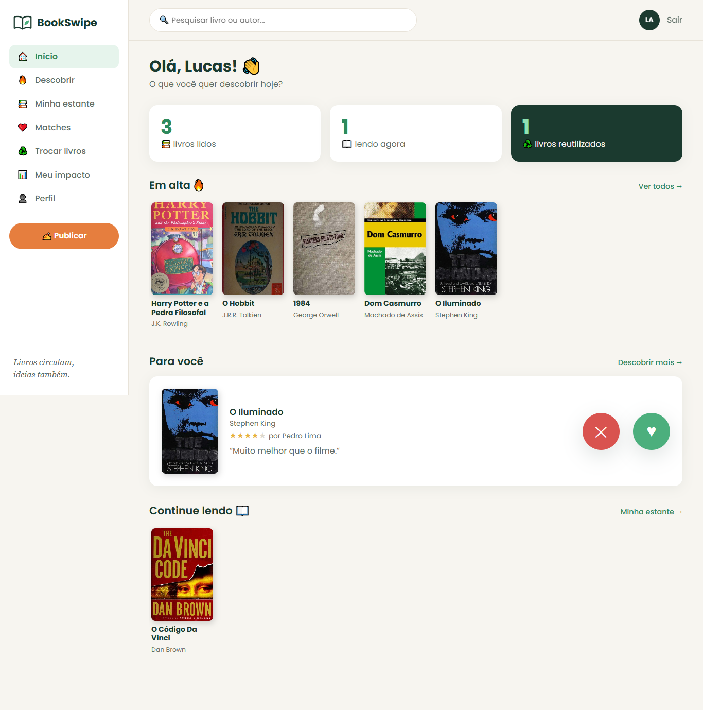

---

## Sumário

- [Funcionalidades](#funcionalidades)
- [Tecnologias](#tecnologias)
- [Arquitetura](#arquitetura)
- [Banco de dados](#banco-de-dados)
- [Como rodar o projeto](#como-rodar-o-projeto)
- [API REST](#api-rest)
- [Segurança](#segurança)
- [Telas](#telas)
- [Estrutura de pastas](#estrutura-de-pastas)

---

## Funcionalidades

| Área | O que faz |
|---|---|
| **Conta** | Cadastro com escolha de gêneros favoritos, login e logout |
| **Descobrir** | Cards de experiências de leitura de outros alunos; arrastar para a direita = curtir, para a esquerda = pular |
| **Rede social** | Publicar experiência (nota de 0 a 5, sentimento, texto, trecho favorito), curtir e comentar |
| **Catálogo** | Pesquisa de livros no banco e **busca na internet** (Open Library ou Google Books) para importar título, autor, sinopse e capa |
| **Minha estante** | Livros marcados como *quero ler*, *lendo* ou *lido*, além dos favoritos |
| **Match** | Porcentagem de afinidade com outros alunos, calculada pelos livros e gêneros em comum |
| **Trocas** | Oferecer um livro, pedir um livro, e aceitar, recusar ou concluir a troca |
| **Meu impacto** | Indicadores de sustentabilidade: livros reaproveitados, taxa de troca, engajamento e ranking |

O sistema tem **duas interfaces** que usam as mesmas regras de negócio:

1. **Console em Java**, com menus no terminal
2. **Site (HTML, CSS e JavaScript)**, que conversa com uma API REST em Java

---

## Tecnologias

| Camada | Tecnologia |
|---|---|
| Linguagem | Java 21 |
| Build | Maven |
| Banco de dados | MySQL 8, com SQL escrito à mão e acesso via **JDBC** puro (sem ORM) |
| API REST | Javalin 6.3 + Jackson 2.17 |
| Senhas | BCrypt (jbcrypt 0.4) |
| Front-end | HTML, CSS e JavaScript puro (sem framework) |
| APIs externas | Open Library (gratuita) e Google Books (opcional, com chave) |

---

## Arquitetura

O projeto é dividido em camadas. Cada camada só conversa com a camada de baixo:

```
 Site (HTML/JS)          Console (menus)
       │                       │
       ▼                       │
 API REST (Javalin)            │
  pacote api/                  │
       │                       │
       └──────────┬────────────┘
                  ▼
           Services (regras de negócio)
           pacote service/
                  │
                  ▼
           DAOs (SQL + JDBC)
           pacote dao/
                  │
                  ▼
              MySQL
```

| Pacote | Responsabilidade |
|---|---|
| `model` | Classes que representam as tabelas (`Usuario`, `Livro`, `Experiencia`...) e enums (`StatusLeitura`, `StatusSolicitacao`...) |
| `dao` | Um DAO por tabela, com todo o SQL (`INSERT`, `SELECT` com `JOIN`, transações) |
| `service` | Regras de negócio: match, indicadores, regras de troca, hash de senha, sessão |
| `console` | Interface de terminal (`MenuPrincipal` é o `main`) |
| `api` | Servidor HTTP e controllers da API REST (`ApiServidor` é o `main`) |
| `externo` | Busca de livros na internet (interface `BuscadorDeLivros` com duas implementações) |

### Como o match é calculado

A afinidade entre dois alunos usa o **índice de Jaccard** (itens em comum ÷ total de itens dos dois):

- **60%**: livros de interesse em comum (livros *lidos* ou *favoritos* na estante)
- **40%**: gêneros favoritos em comum

### Regras de troca

- Não é possível pedir o próprio livro
- O livro precisa estar *disponível*
- Só o dono do livro pode aceitar ou recusar o pedido
- Ao concluir, o livro sai do marketplace e a troca entra nos indicadores de impacto

---

## Banco de dados

Banco **`bookswipe`** no MySQL, com **11 tabelas** divididas em 4 grupos: pessoas, catálogo, rede social e troca sustentável.

### Modelo relacional

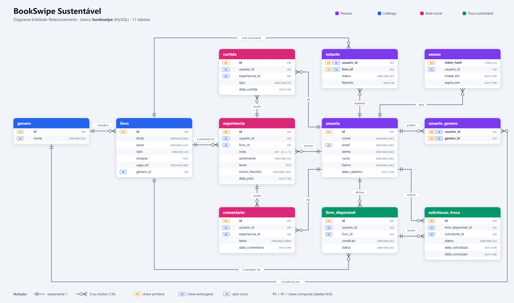

| Tabela | Para que serve |
|---|---|
| `usuario` | Alunos cadastrados (a senha é guardada como hash BCrypt) |
| `sessao` | Tokens de login (guardados como hash SHA-256, expiram em 7 dias) |
| `genero` | Gêneros literários |
| `usuario_genero` | Gêneros favoritos de cada aluno (relação N:N) |
| `livro` | Catálogo de livros |
| `estante` | Livros de cada aluno com status de leitura e favorito (relação N:N) |
| `experiencia` | Post de leitura: nota, sentimento, texto e trecho favorito |
| `curtida` | Curtidas nas experiências |
| `comentario` | Comentários nas experiências |
| `livro_disponivel` | Livro físico que um aluno oferece para troca |
| `solicitacao_troca` | Pedido de troca (pendente, aceita, recusada ou concluída) |

### Scripts SQL (pasta `banco/`)

| Arquivo | O que faz |
|---|---|
| `01_criar_tabelas.sql` | Cria o banco e todas as tabelas (apaga e recria do zero) |
| `02_dados_teste.sql` | Insere dados de exemplo: 6 usuários, livros, experiências e trocas |
| `03_capas.sql` | Coloca as capas reais dos livros de exemplo |
| `04_sessao.sql` | Cria só a tabela `sessao` (para bancos criados antes dela existir) |

---

## Como rodar o projeto

### 1. Pré-requisitos

- **JDK 21**
- **Maven 3.9** ou superior
- **MySQL 8**
- **VS Code** com a extensão *Live Server* (para abrir o site)

### 2. Criar o banco

Rode os scripts no MySQL, nesta ordem:

```bash
mysql -u root -p < banco/01_criar_tabelas.sql
mysql -u root -p < banco/02_dados_teste.sql
mysql -u root -p < banco/03_capas.sql
```

### 3. Configurar a senha do banco

A senha do banco **não vai para o GitHub**. Copie o arquivo de exemplo e preencha com os seus dados:

```bash
cd backend/src/main/resources
cp db.properties.exemplo db.properties
cp apis.properties.exemplo apis.properties
```

```properties
# db.properties
db.url=jdbc:mysql://localhost:3306/bookswipe
db.usuario=root
db.senha=SUA_SENHA_AQUI
```

O `apis.properties` pode ficar vazio. Assim o sistema usa a Open Library, que é gratuita. Se você colocar uma chave do Google Books, ele passa a usar a Google Books.

### 4. Rodar o console

```bash
cd backend
mvn compile exec:java -Dexec.mainClass=com.bookswipe.console.MenuPrincipal
```

### 5. Rodar a API e o site

Suba a API (ela fica em `http://localhost:7070/api`):

```bash
cd backend
mvn compile exec:java -Dexec.mainClass=com.bookswipe.api.ApiServidor
```

Depois abra a pasta `site/` no VS Code, clique com o botão direito em `index.html` e escolha **Open with Live Server**.

> No VS Code também dá para rodar clicando em **Run** em cima do método `main` de `MenuPrincipal` ou de `ApiServidor`.

### Usuários de teste

Todos os usuários de exemplo usam a senha **`123456`**:

`lucas@bookswipe.com` · `ana@bookswipe.com` · `joao@bookswipe.com` · `eliane@bookswipe.com` · `mariana@bookswipe.com` · `pedro@bookswipe.com`

---

## API REST

Endereço base: `http://localhost:7070/api`. As respostas são em JSON, e os erros vêm como `{"erro": "mensagem"}`.

<details>
<summary><b>Ver todas as rotas</b></summary>

**Conta**

| Método | Rota | Descrição |
|---|---|---|
| POST | `/api/usuarios` | Criar conta *(pública)* |
| POST | `/api/login` | Login, devolve `{token, usuario}` *(pública)* |
| POST | `/api/logout` | Encerrar a sessão |
| GET | `/api/eu` | Dados do usuário logado |
| GET | `/api/generos` | Lista de gêneros *(pública)* |
| GET / PUT | `/api/usuarios/{id}/generos` | Ver ou alterar os gêneros favoritos |

**Livros e estante**

| Método | Rota | Descrição |
|---|---|---|
| GET | `/api/livros` | Listar ou pesquisar livros |
| GET | `/api/livros/{id}` | Detalhes de um livro |
| POST | `/api/livros` | Cadastrar livro |
| GET | `/api/catalogo-externo` | Buscar livros na internet |
| POST | `/api/livros/importar` | Importar livro da internet |
| POST | `/api/livros/{id}/completar` | Completar capa e sinopse pela internet |
| GET | `/api/usuarios/{id}/estante` | Estante do usuário |
| GET | `/api/usuarios/{id}/estante/totais` | Totais por status |
| PUT / DELETE | `/api/usuarios/{id}/estante/{livroId}` | Colocar ou tirar livro da estante |
| POST | `/api/usuarios/{id}/estante/{livroId}/favorito` | Marcar ou desmarcar favorito |

**Rede social**

| Método | Rota | Descrição |
|---|---|---|
| GET | `/api/usuarios/{id}/descobrir` | Cards para o swipe |
| GET | `/api/usuarios/{id}/experiencias` | Experiências do usuário |
| GET | `/api/livros/{id}/experiencias` | Experiências de um livro |
| POST | `/api/experiencias` | Publicar experiência |
| POST | `/api/experiencias/{id}/avaliacao` | Curtir ou pular |
| GET / POST | `/api/experiencias/{id}/comentarios` | Ver ou escrever comentários |
| GET | `/api/usuarios/{id}/matches` | Alunos com mais afinidade |

**Trocas e impacto**

| Método | Rota | Descrição |
|---|---|---|
| GET / POST | `/api/trocas/disponiveis` | Marketplace / oferecer livro |
| GET | `/api/usuarios/{id}/livros-oferecidos` | Livros que o usuário oferece |
| POST | `/api/trocas/pedidos` | Pedir uma troca |
| GET | `/api/usuarios/{id}/pedidos-recebidos` | Pedidos recebidos |
| GET | `/api/usuarios/{id}/pedidos-feitos` | Pedidos feitos |
| PUT | `/api/trocas/pedidos/{id}/aceitar` | Aceitar pedido |
| PUT | `/api/trocas/pedidos/{id}/recusar` | Recusar pedido |
| PUT | `/api/trocas/pedidos/{id}/concluir` | Concluir troca |
| GET | `/api/indicadores` | Indicadores gerais de impacto *(pública)* |
| GET | `/api/usuarios/{id}/impacto` | Impacto do usuário |

</details>

---

## Segurança

- **Senhas com hash BCrypt.** A senha nunca é salva em texto puro.
- **Login por token.** O login gera um token aleatório (`SecureRandom`, 32 bytes). O banco guarda só o hash SHA-256 dele, e o token vale 7 dias. O site envia o token no cabeçalho `Authorization: Bearer`.
- **Rotas protegidas.** Só login, cadastro, gêneros e indicadores são públicas. O usuário só consegue alterar os próprios dados; se tentar mexer nos de outro, recebe o erro 403.
- **Proteção contra SQL Injection.** Todas as consultas usam `PreparedStatement`.
- **Proteção contra XSS.** O site escapa os textos antes de mostrar na tela.
- **Senha do banco fora do Git.** Os arquivos `db.properties` e `apis.properties` estão no `.gitignore`.

---

## Telas

| Landing page | Descobrir (swipe) |
|---|---|
| 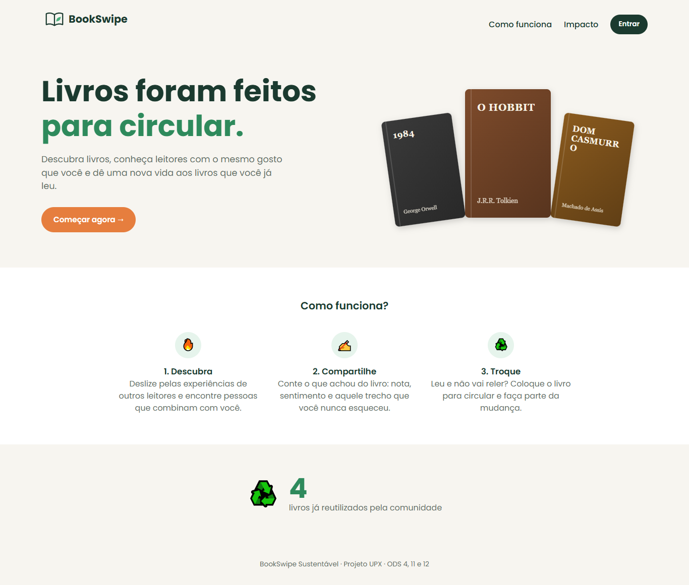 | 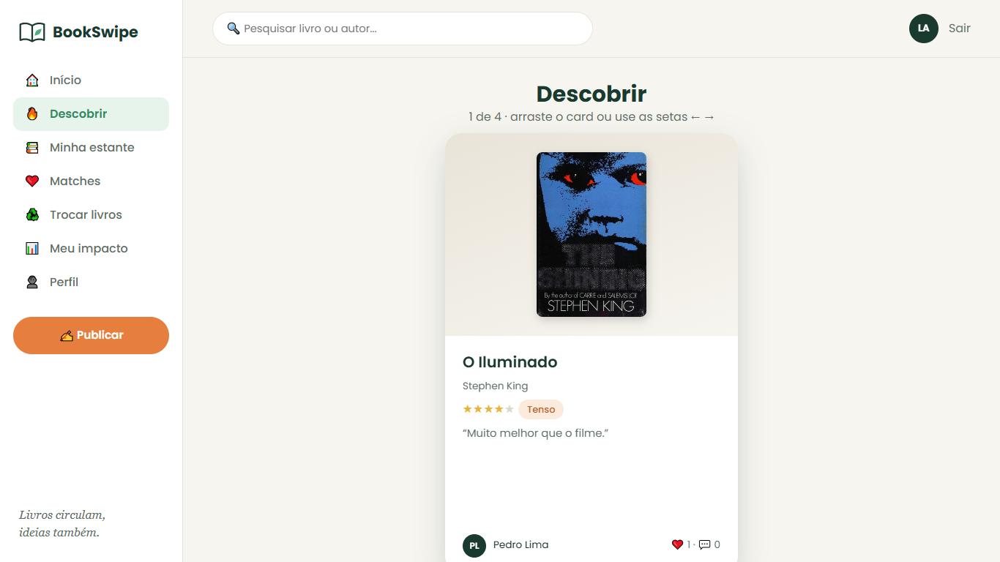 |

| Matches | Trocas |
|---|---|
| 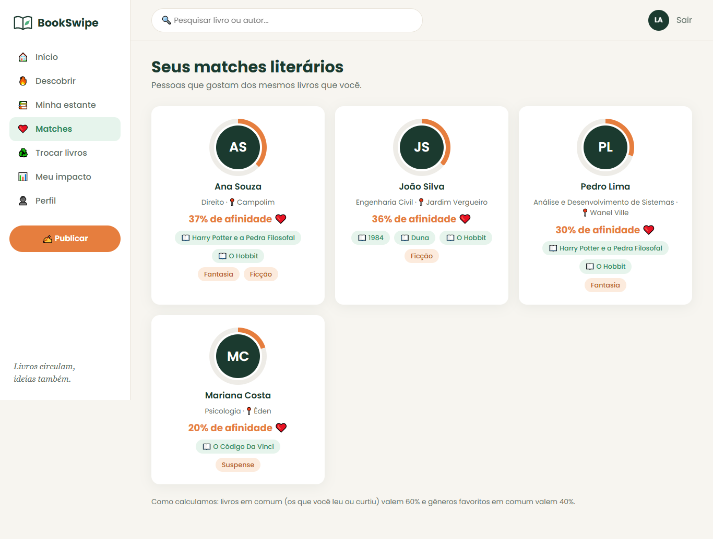 | 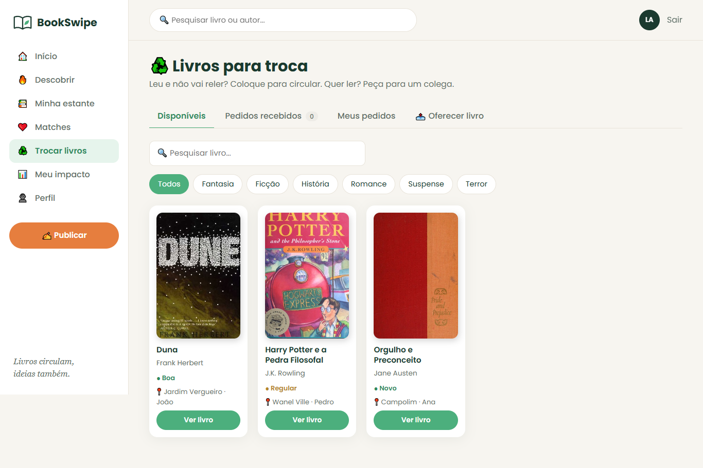 |

| Minha estante | Meu impacto |
|---|---|
| 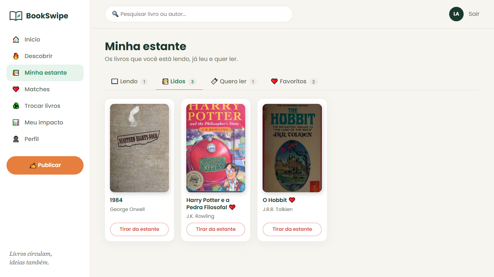 | 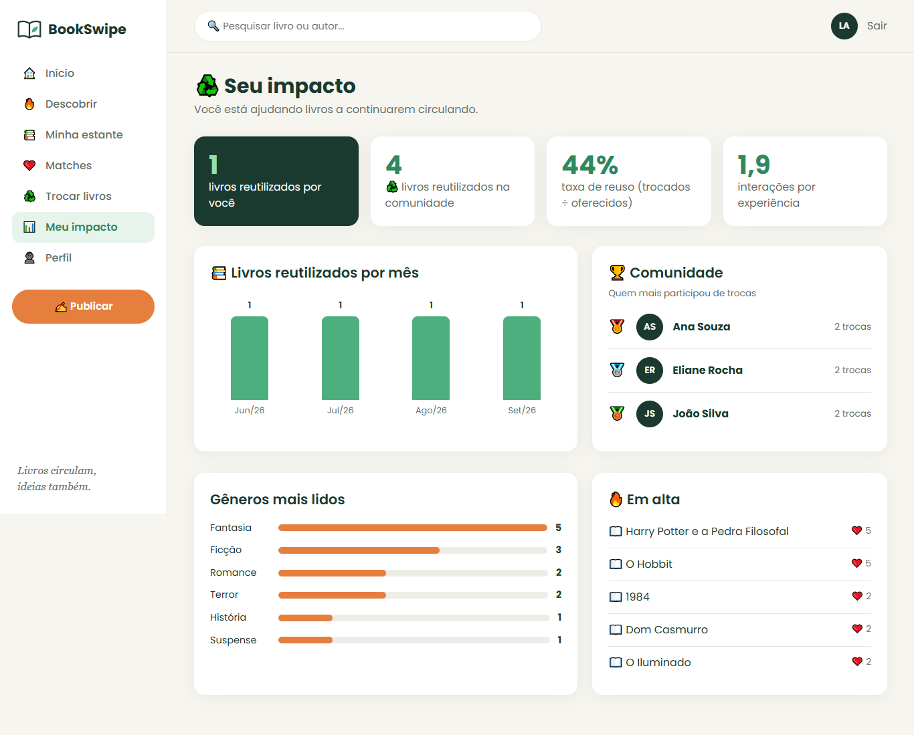 |

| Celular |  |  |
|---|---|---|
| 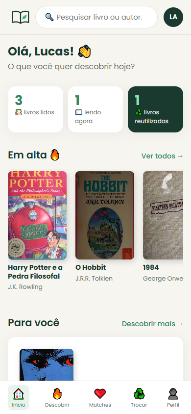 | 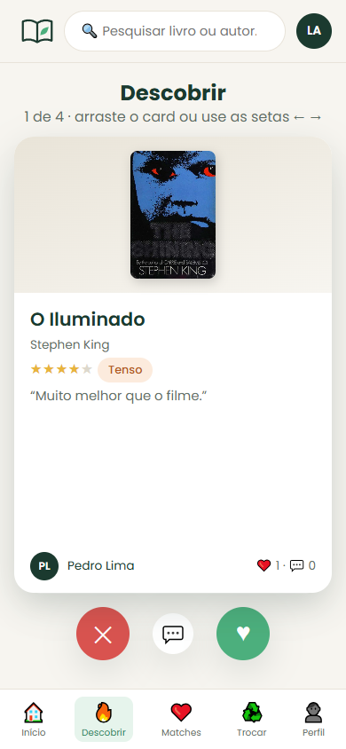 | 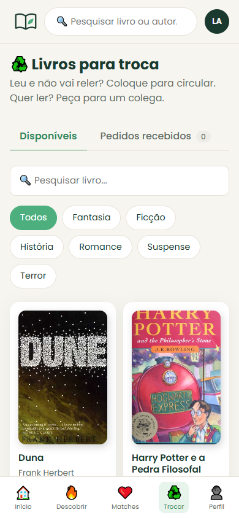 |

As outras telas estão na pasta [`entrega/img`](entrega/img).

---

## Estrutura de pastas

```
BookSwipe/
├── banco/                  scripts SQL + modelo relacional (DER)
├── backend/                projeto Java (Maven)
│   ├── pom.xml
│   └── src/main/
│       ├── java/com/bookswipe/
│       │   ├── model/      entidades e enums
│       │   ├── dao/        acesso ao banco (JDBC)
│       │   ├── service/    regras de negócio
│       │   ├── console/    interface de terminal
│       │   ├── api/        API REST (Javalin)
│       │   └── externo/    Open Library / Google Books
│       └── resources/      db.properties e apis.properties (modelos .exemplo)
├── site/                   front-end (HTML, CSS, JS)
└── entrega/                banner, telas e PDFs da entrega
```
